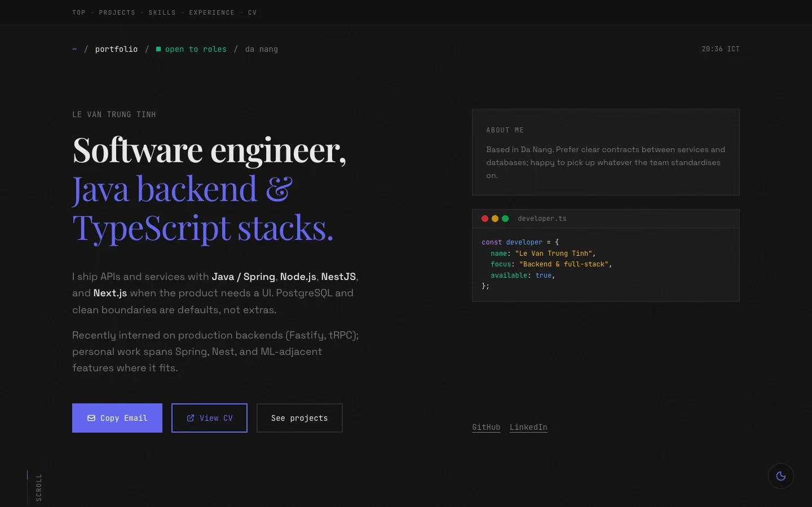

# Trung Tinh — Personal Portfolio

Source code for [trungtinh.site](https://trungtinh.site), the personal portfolio of Lê Văn Trung Tính. It is a single-page Next.js site that presents selected projects, technical skills, and work experience, with a downloadable CV.

[](https://trungtinh.site)




## Key features

- **Single-page layout** with anchored sections — Hero, Projects, Skills, Experience — and a sticky section navigator (`components/portfolio/section-nav.tsx`).
- **Project case studies.** Each project row opens an accessible modal (`role="dialog"`, `aria-modal`) with the challenge, solution, features, stack, and links (`components/portfolio/projects.tsx`).
- **Light and dark themes** via `next-themes`, with a floating toggle (`components/theme-toggle.tsx`).
- **One-click contact.** "Copy email" uses the Clipboard API; the CV is served as a static PDF from `public/`.
- **Search-engine ready.** App Router metadata, Open Graph tags, JSON-LD `Person` schema, `sitemap.ts`, and `robots.ts`.
- **Motion with restraint.** Entrance and in-view transitions with Framer Motion.
- **Vercel Analytics** for page-view tracking.

## Tech stack

| Layer | Technology |
| --- | --- |
| Framework | Next.js 16 (App Router), React 19 |
| Language | TypeScript 5 |
| Styling | Tailwind CSS 4, CSS variables, shadcn/ui (Radix primitives) |
| Motion | Framer Motion 12 |
| Fonts | Space Grotesk, JetBrains Mono, Playfair Display (`next/font/google`) |
| Hosting | Vercel (custom domain `trungtinh.site`) |

## Project structure

```text
app/
  layout.tsx          Root layout: fonts, metadata, JSON-LD, theme provider, analytics
  page.tsx            Composes the portfolio sections
  sitemap.ts          Generated sitemap
  robots.ts           Crawl rules
components/
  portfolio/          Page sections: hero, projects, skills, experience, footer, section-nav
  ui/                 shadcn/ui primitives
  theme-provider.tsx  next-themes wrapper
  theme-toggle.tsx    Light/dark switch
public/               CV (PDF), project screenshots, icons
```

Content (projects, skills, experience) lives as typed arrays at the top of each section component, so updating the site is a data edit rather than a layout change.

## Getting started

**Prerequisites:** Node.js 20.9 or newer and [pnpm](https://pnpm.io/).

```bash
git clone https://github.com/tinhne/Tinh-Porfolio.git
cd Tinh-Porfolio
pnpm install
pnpm dev
```

Open <http://localhost:3000>.

| Command | Description |
| --- | --- |
| `pnpm dev` | Start the development server |
| `pnpm build` | Create a production build |
| `pnpm start` | Serve the production build |

No environment variables are required.

## Deployment

The site is deployed on Vercel and served from the custom domain [trungtinh.site](https://trungtinh.site).

## Author

**Lê Văn Trung Tính** — Software Engineer | AI Product Builder

- Website: [trungtinh.site](https://trungtinh.site)
- GitHub: [@tinhne](https://github.com/tinhne)
