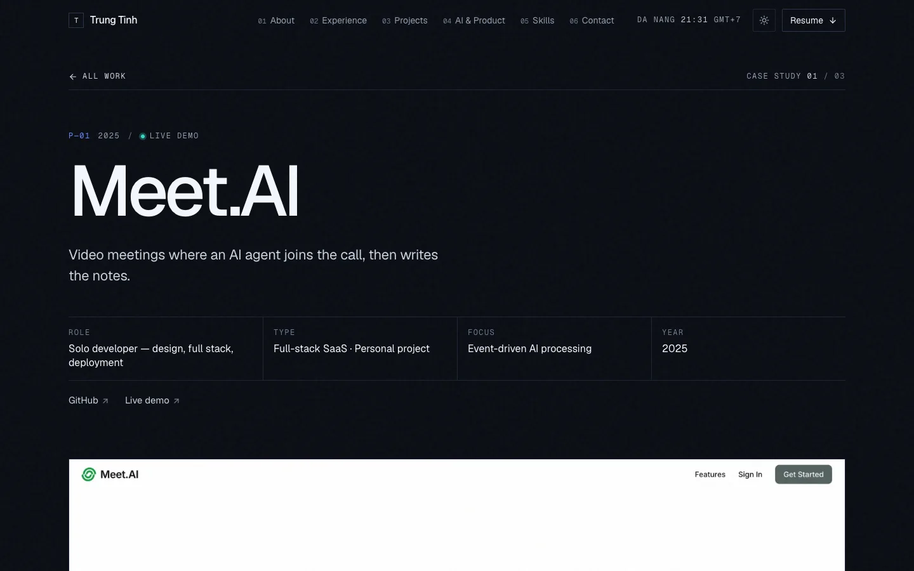

# Trung Tinh — Personal Portfolio

Source code for [trungtinh.site](https://trungtinh.site), the portfolio of Lê Văn Trung Tính, Software Engineer · AI Product Builder. It is a statically generated Next.js site with a home page covering experience, projects, AI work, skills, and achievements, plus a long-form case study page for each featured project.

[](https://trungtinh.site)


## Key features

- **Content as data.** Everything shown on the site — profile, experience, projects, case studies, skills, achievements — lives in typed objects in `lib/content.ts`. Updating the portfolio is a data edit, not a layout change.
- **Home page sections:** Hero with an animated system map, About, Experience, Projects (featured case studies plus an archive list), AI & Product, Skills, Achievements, and Contact (`app/page.tsx`, `components/portfolio/`).
- **Case study pages.** `/work/[slug]` is statically generated for every featured project with `generateStaticParams`, and includes role, stack, features, challenges, an architecture diagram, and screenshots.
- **Evidence-linked skills.** Skills and AI capabilities reference the projects or roles where they were actually used, so each claim links to its proof.
- **Generated social images.** Open Graph images for the home page and each case study are rendered at build time with `next/og` (`app/opengraph-image.tsx`, `app/work/[slug]/opengraph-image.tsx`, `lib/og.tsx`).
- **SEO.** App Router metadata, per-page canonical URLs, JSON-LD `Person` schema, `sitemap.ts`, and `robots.ts`.
- **Accessible navigation.** Sticky nav with active-section state (`aria-current`), a mobile menu that closes on Escape, and a custom 404 page.
- **Motion that respects the user.** Scroll reveals, parallax and scroll-linked text use Framer Motion with `reducedMotion="user"`, and CSS animations are gated behind `prefers-reduced-motion`.
- **Dark-first theming** with a light-mode toggle (`next-themes`).
- **Vercel Analytics** for page-view tracking.



## Tech stack

| Layer | Technology |
| --- | --- |
| Framework | Next.js 16 (App Router, static generation), React 19 |
| Language | TypeScript 5 (type-checked during `next build`) |
| Styling | Tailwind CSS 4, CSS variables, shadcn/ui (Radix primitives) |
| Motion | Framer Motion 12 |
| Fonts | Geist and Geist Mono (`next/font/google`) |
| Social images | `next/og` (`ImageResponse`) |
| Hosting | Vercel, custom domain `trungtinh.site` |

## Project structure

```text
app/
  layout.tsx                 Root layout: fonts, metadata, JSON-LD, providers, analytics
  page.tsx                   Home page — composes the portfolio sections
  work/[slug]/page.tsx       Case study page per featured project
  opengraph-image.tsx        Generated OG image (home); one per case study under work/[slug]/
  template.tsx               Page fade-in on route change
  not-found.tsx, sitemap.ts, robots.ts
components/
  portfolio/                 Sections (hero, about, experience, projects, ai-builder, skills,
                             achievements, contact) and building blocks (nav, system-map,
                             architecture-diagram, reveal, parallax-image, primitives)
  providers.tsx              Theme + motion configuration
  ui/                        shadcn/ui primitives
lib/
  content.ts                 Single source of truth for all site content
  og.tsx                     Shared Open Graph image renderer
public/
  projects/                  Project screenshots (WebP)
  LeVanTrungTinh_CV.pdf      Downloadable resume
```

## Getting started

**Prerequisites:** Node.js 20.9 or newer and [pnpm](https://pnpm.io/).

```bash
git clone https://github.com/tinhne/Tinh-Porfolio.git
cd Tinh-Porfolio
pnpm install
pnpm dev
```

Open <http://localhost:3000>.

| Command | Description |
| --- | --- |
| `pnpm dev` | Start the development server |
| `pnpm build` | Type-check and create a production build (all pages prerendered) |
| `pnpm start` | Serve the production build |

No environment variables are required.

### Editing content

Edit `lib/content.ts`. To add a case study, append an entry to `projects` with a unique `slug` and put its screenshots in `public/projects/`. The page, its Open Graph image, and its sitemap entry are generated automatically.

## Deployment

The site is deployed on Vercel and served from the custom domain [trungtinh.site](https://trungtinh.site).

## Author

**Lê Văn Trung Tính** — Software Engineer | AI Product Builder

- Website: [trungtinh.site](https://trungtinh.site)
- GitHub: [@tinhne](https://github.com/tinhne)
